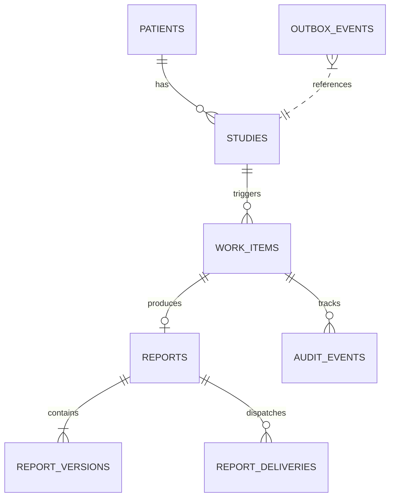

# Relational Data Model & Persistence Specification

## 1. Entity-Relationship Overview

The persistence architecture of the SIMS Radiology platform is designed around PostgreSQL 16. It combines relational integrity, JSONB semi-structured clinical payloads, append-only immutable audit logging, and transactional outbox guarantees.



---

## 2. Table Specifications & Schema Definitions

### 2.1 Table: `patients`
Stores master patient index (MPI) identity records.

| Column | Type | Constraints | Description |
|---|---|---|---|
| `id` | `VARCHAR(64)` | `PRIMARY KEY` | Internal surrogate patient identifier |
| `mrn` | `VARCHAR(64)` | `UNIQUE, NOT NULL` | Medical Record Number from hospital EHR/HMS |
| `first_name` | `VARCHAR(128)` | `NOT NULL` | Patient given name (scrubbed in external traces) |
| `last_name` | `VARCHAR(128)` | `NOT NULL` | Patient surname (scrubbed in external traces) |
| `dob` | `DATE` | `NOT NULL` | Date of birth |
| `gender` | `VARCHAR(16)` | `NOT NULL` | Administrative gender (`M`, `F`, `O`, `U`) |
| `clinical_history` | `JSONB` | `DEFAULT '{}'` | Prior known allergies, surgeries, chronic conditions |
| `created_at` | `TIMESTAMPTZ` | `DEFAULT NOW()` | Timestamp of patient record creation |
| `updated_at` | `TIMESTAMPTZ` | `DEFAULT NOW()` | Timestamp of last record update |

**Indexes:**
- `idx_patients_mrn`: `btree (mrn)` - O(log N) lookup for inbound accession reconciliation.

---

### 2.2 Table: `studies`
Stores imaging study metadata ingested from PACS and BackBone HMS.

| Column | Type | Constraints | Description |
|---|---|---|---|
| `id` | `VARCHAR(64)` | `PRIMARY KEY` | Internal study identifier |
| `study_instance_uid` | `VARCHAR(128)` | `UNIQUE, NOT NULL` | DICOM Study Instance UID (ISO/IEC 8824 standard) |
| `accession_number` | `VARCHAR(64)` | `NOT NULL` | Hospital HMS order accession number |
| `patient_id` | `VARCHAR(64)` | `FK -> patients(id)` | Foreign key reference to master patient |
| `modality` | `VARCHAR(16)` | `NOT NULL` | Imaging modality (`CT`, `MR`, `XR`, `US`, `NM`) |
| `procedure_description`| `VARCHAR(255)` | `NOT NULL` | Anatomical procedure (e.g. `CT Chest with IV Contrast`) |
| `study_date` | `TIMESTAMPTZ` | `NOT NULL` | Acquisition timestamp from DICOM header |
| `series_count` | `INTEGER` | `DEFAULT 1` | Total imaging series in study |
| `instance_count` | `INTEGER` | `DEFAULT 0` | Total DICOM frames/slices |
| `pacs_series_uids` | `JSONB` | `DEFAULT '[]'` | Array of Series Instance UIDs |
| `metadata` | `JSONB` | `DEFAULT '{}'` | Extracted DICOM tags (kVp, slice thickness, etc.) |

**Indexes:**
- `idx_studies_uid`: `btree (study_instance_uid)`
- `idx_studies_accession`: `btree (accession_number)`
- `idx_studies_patient_modality`: `btree (patient_id, modality, study_date DESC)` - Optimizes prior study queries.

---

### 2.3 Table: `work_items`
Operational state machine entity tracking reading priority, assignment, and SLA deadlines.

| Column | Type | Constraints | Description |
|---|---|---|---|
| `id` | `VARCHAR(64)` | `PRIMARY KEY` | Unique work item identifier |
| `study_id` | `VARCHAR(64)` | `FK -> studies(id)` | Foreign key reference to radiology study |
| `status` | `VARCHAR(32)` | `NOT NULL` | Workflow state: `RECEIVED`, `READY`, `ASSIGNED`, `IN_REVIEW`, `DRAFT_READY`, `FINALIZED`, `DELIVERED`, `QUARANTINED` |
| `priority` | `VARCHAR(16)` | `NOT NULL` | Triage priority: `STAT` (15m), `URGENT` (60m), `ROUTINE` (24h) |
| `assigned_radiologist_id`| `VARCHAR(64)`| `NULL` | Assigned clinician ID |
| `assignment_reason` | `VARCHAR(128)`| `NULL` | Reason code for assignment/reassignment |
| `quarantine_reason` | `VARCHAR(255)`| `NULL` | Reason string if study failed reconciliation |
| `sla_deadline` | `TIMESTAMPTZ` | `NOT NULL` | Target completion time based on priority |
| `shap_attribution_vector`| `JSONB` | `DEFAULT '{}'` | SHAP feature weights explaining priority/delay |
| `created_at` | `TIMESTAMPTZ` | `DEFAULT NOW()` | Ingestion timestamp |
| `updated_at` | `TIMESTAMPTZ` | `DEFAULT NOW()` | Last workflow transition timestamp |

**Indexes:**
- `idx_work_items_status_priority`: `btree (status, priority, sla_deadline ASC)` - Powers real-time radiologist worklist query.
- `idx_work_items_assigned`: `btree (assigned_radiologist_id, status)`

---

### 2.4 Table: `reports` & `report_versions` (Append-Only Immutability)
Stores diagnostic interpretations, structured findings, and version history.

#### Table: `reports`
| Column | Type | Constraints | Description |
|---|---|---|---|
| `id` | `VARCHAR(64)` | `PRIMARY KEY` | Diagnostic report master record ID |
| `work_item_id` | `VARCHAR(64)` | `FK -> work_items(id)` | Reference to work item |
| `patient_id` | `VARCHAR(64)` | `FK -> patients(id)` | Reference to patient |
| `study_id` | `VARCHAR(64)` | `FK -> studies(id)` | Reference to study |
| `current_version_number`| `INTEGER` | `DEFAULT 1` | Incremental version counter |
| `status` | `VARCHAR(32)` | `NOT NULL` | Master report status (`DRAFT`, `FINALIZED`, `AMENDED`) |

#### Table: `report_versions` (Strict Append-Only)
| Column | Type | Constraints | Description |
|---|---|---|---|
| `id` | `VARCHAR(64)` | `PRIMARY KEY` | Version record ID |
| `report_id` | `VARCHAR(64)` | `FK -> reports(id)` | Parent report foreign key |
| `version_number` | `INTEGER` | `NOT NULL` | Incremental integer (1, 2, 3...) |
| `clinical_indication`| `TEXT` | `NULL` | Referral reason from HMS order |
| `findings` | `TEXT` | `NOT NULL` | Anatomical and pathological observations |
| `impression` | `TEXT` | `NOT NULL` | Final diagnostic conclusion |
| `recommendations`| `TEXT` | `NULL` | Clinical follow-up recommendations |
| `is_ai_generated` | `BOOLEAN` | `DEFAULT FALSE`| Whether drafted by Deep Agent |
| `finalized_by` | `VARCHAR(64)` | `NULL` | Clinician ID who signed the report |
| `finalized_at` | `TIMESTAMPTZ` | `NULL` | Sign-off timestamp |
| `cryptographic_signature`| `VARCHAR(128)`| `NULL` | SHA-256 HMAC signature of findings + impression |

---

## 3. Database-Level Immutability Enforcement (TC-033)

To comply with FDA Title 21 CFR Part 11 and hospital medical-legal guidelines, finalized report versions can **never** be updated or deleted. This is enforced at two distinct architectural levels:

### 3.1 PostgreSQL Trigger Implementation
```sql
CREATE OR REPLACE FUNCTION prevent_report_version_mutation()
RETURNS TRIGGER AS $$
BEGIN
    IF OLD.finalized_at IS NOT NULL THEN
        RAISE EXCEPTION 'SQLSTATE 23514: Tamper violation: finalized report version % is immutable and cannot be updated or deleted.', OLD.id;
    END IF;
    RETURN NEW;
END;
$$ LANGUAGE plpgsql;

CREATE TRIGGER trg_report_version_immutable_update
BEFORE UPDATE ON report_versions
FOR EACH ROW EXECUTE FUNCTION prevent_report_version_mutation();

CREATE TRIGGER trg_report_version_immutable_delete
BEFORE DELETE ON report_versions
FOR EACH ROW EXECUTE FUNCTION prevent_report_version_mutation();
```

### 3.2 SQLAlchemy ORM Event Listener
In addition to database triggers, Python domain listeners in `core/infrastructure/persistence/models.py` intercept mutations before queries reach the database:

```python
@event.listens_for(ReportVersionModel, "before_update")
def check_report_version_before_update(mapper, connection, target):
    if target.finalized_at is not None:
        raise PermissionError(f"Report version '{target.id}' is finalized and immutable.")
```

---

## 4. Transactional Outbox Pattern (`outbox_events`)

To prevent dual-write inconsistencies between PostgreSQL and Celery/Kestra, events are published using the Transactional Outbox pattern:

```sql
CREATE TABLE outbox_events (
    id VARCHAR(64) PRIMARY KEY,
    aggregate_type VARCHAR(64) NOT NULL,
    aggregate_id VARCHAR(64) NOT NULL,
    event_type VARCHAR(64) NOT NULL,
    payload JSONB NOT NULL,
    created_at TIMESTAMPTZ DEFAULT NOW(),
    processed_at TIMESTAMPTZ NULL
);

CREATE INDEX idx_outbox_unprocessed ON outbox_events (created_at ASC) WHERE processed_at IS NULL;
```

**Worker Polling Logic:**
```sql
SELECT * FROM outbox_events
WHERE processed_at IS NULL
ORDER BY created_at ASC
LIMIT 50
FOR UPDATE SKIP LOCKED;
```
`SKIP LOCKED` allows multiple Celery worker threads to consume batches without lock contention or duplicate event dispatching.
